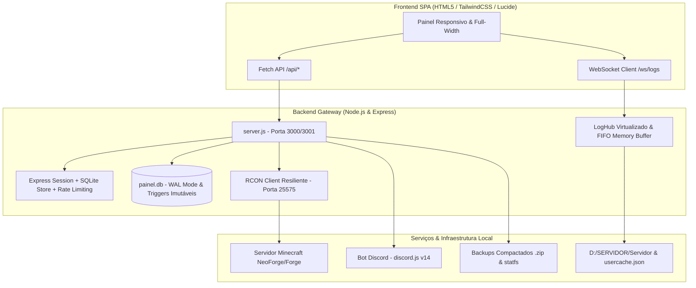

# Monkey's Craft Control Panel 🎮🐒

Painel de controle web corporativo e autônomo para gerenciamento operacional de servidores de **Minecraft (NeoForge 1.21.1 / Forge 1.20.1)** e integração com **Discord Bot (Discord.js v14)**.

---

## 🏗️ Arquitetura do Sistema

O painel foi projetado para alta confiabilidade, segurança e monitoramento em tempo real sem degradação do loop principal:



### Principais Componentes Técnicos:
- **Node.js & Express:** Gateway com proxy interno, sessões assinadas com cookies `HttpOnly`/`SameSite` e rate limiting por IP.
- **WebSockets (`ws`):** Transmissão de telemetria, logs de console e eventos de saúde em tempo real com auto-reconexão e detecção de heartbeat.
- **Banco Relacional SQLite (`better-sqlite3`):** Modo `WAL` (Write-Ahead Logging), triggers imutáveis de auditoria (`audit_logs`), tabelas de sanções, regras de facções e tokens de vínculo UUID.
- **Protocolo RCON:** Canal de comunicação bidirecional de baixa latência para execução de comandos (`list`, `forge tps`, `tellraw`, `kick`, `ban`) e reconciliação com o `usercache.json` do servidor.
- **Motor de Backups Hot/Online:** Criação, exclusão e inspeção segura de arquivos `.zip` sem extração completa via `node-stream-zip`, calculando espaço livre real da unidade em disco via `fs.statfsSync`.

---

## 🖥️ Módulos e Abas do Painel

1. **Visão Geral & Consoles:**
   - Consoles simultâneos e virtualizados para o servidor Minecraft e Bot Discord (altura uniforme de 520px com buffer de até 5.000 linhas).
   - KPIs de CPU, RAM, TPS, MSPT e Contagem Real de Jogadores (`0/32`).
   - Controle de ciclo de vida (Ligar, Desligar com contagem regressiva e Reiniciar).

2. **Gestão de Jogadores & Punições:**
   - Tabela de jogadores online em tempo real com nicks reais, UUIDs oficiais, ping, dimensão e facção.
   - Punições administrativas (Kick, Ban temporário/permanente) com respeito estrito à hierarquia de cargos e registro imutável de auditoria.
   - Ações rápidas: Mensagem direta (DM), teleporte e controle de Whitelist.

3. **Facções, Territórios & Raids:**
   - Leitura nativa de dados dos mods `ftbteams` e `ftbchunks`.
   - Controle manual e agendado da **Janela de Raids** com avisos globais em JSON (`tellraw`).
   - Gaveta de inspeção detalhada de líderes e membros.

4. **Mods & Eras de Progressão:**
   - Gestão declarativa de Eras tecnológicas (Create, Mekanism, Apotheosis).
   - Tabela compacta com badges de status, proteção contra dependências circulares e modal de detalhes técnicos (Checksum SHA-256 e caminhos de arquivo).

5. **Backups & Recuperação de Desastres:**
   - Métricas de disco em tempo real (`D:/`) e espaço total consumido por backups.
   - Modal de inspeção interna de pacotes `.zip` permitindo leitura inline de arquivos de configuração (`.properties`, `.json`, `.yml`, `.toml`, `.log`) de até 2 MB sem descompactação.

6. **Configurações, Segurança & Auditoria:**
   - Gerenciamento de operadores do painel com suporte a 2FA (TOTP RFC 6238).
   - Vínculo seguro de contas Minecraft via comando `/vincular <TOKEN>` in-game com renderização da skin real do operador via `mc-heads.net`.
   - Trilha de auditoria à prova de modificações (`BEFORE UPDATE/DELETE RAISE(ABORT)`).

---

## 🚀 Instalação e Execução

### Pré-requisitos
- **Node.js:** Versão 18.x ou superior (Recomendado Node.js 20 LTS ou 24 LTS)
- **Servidor Minecraft:** NeoForge 1.21.1 ou Forge 1.20.1 com RCON habilitado em `server.properties`:
  ```properties
  enable-rcon=true
  rcon.port=25575
  rcon.password=sua_senha_aqui
  broadcast-rcon-to-ops=false
  ```

### Passo a Passo

1. **Clone o repositório:**
   ```bash
   git clone https://github.com/Avvd12/monkeys-craft-panel.git
   cd monkeys-craft-panel
   ```

2. **Instale as dependências:**
   ```bash
   npm install
   ```

3. **Configure as variáveis de ambiente:**
   ```bash
   cp .env.example .env
   ```
   Edite o arquivo `.env` preenchendo o `SESSION_SECRET` e as credenciais do RCON.

4. **Inicie o servidor do painel:**
   ```bash
   node server.js
   ```
   O painel estará acessível no navegador em `http://localhost:3000`.

---

## 🔒 Segurança

- O arquivo `.env`, bancos de dados locais (`.db`), diretórios de backups e arquivos de credenciais estão estritamente isolados e protegidos no `.gitignore`.
- Tokens de sessão são renovados após o login e protegidos contra ataques de CSRF e força bruta por rate limiting.
- Registros na tabela `audit_logs` são protegidos por gatilhos SQLite a nível de banco de dados, impedindo qualquer alteração ou deleção mesmo por administradores.

---

## 📄 Licença

Projeto desenvolvido e mantido para a infraestrutura do **Monkey's Craft Server**. Todos os direitos reservados.
